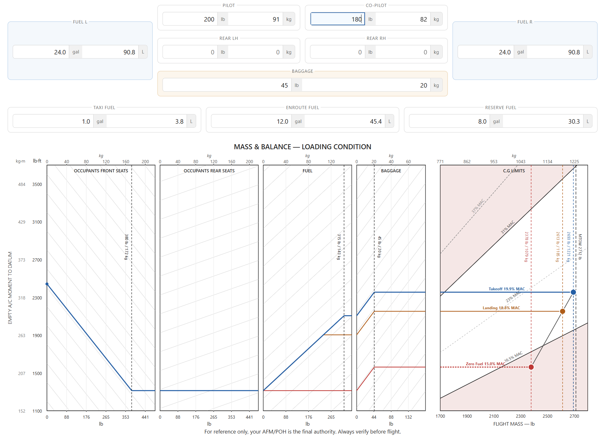

# Tecnam P2006T Weight & Balance Calculator

A browser-based weight, balance, and departure performance calculator for the Tecnam P2006T twin. Built with vanilla JS and no bundler dependency. Enter your load, fetch a METAR for your departure airport, and get POH-interpolated takeoff and landing distances and climb rates for both all-engine and single-engine conditions, plus estimated accelerate-stop and accelerate-go distances. The POH works in metric, but this calculator speaks "freedom units" 🇺🇸😄, so it handles all the kg/lb, L/gal, and kg·m/lb·ft conversions so you don't have to.

**[Run it now on GitHub Pages](https://lrixford.github.io/tecnam-p2006t)**



## Features

- **Loading condition table** with ramp, takeoff, landing, and zero-fuel weights with CG arm and % MAC
- **SVG nomograph and CG envelope** charts that update live for each loading condition
- **W&B suggestion engine** that brings an out-of-limits load back into limits, moving baggage first and giving up fuel last
- **Departure performance** with POH takeoff and landing distances and climb rates, using the airport's weather and the selected runway's surface, slope and true heading
- **Weather station choice** showing which station supplied the report, with nearby alternates to switch to
- **Runway cards** ranked by crosswind and headwind, with wind diagrams and a warning above the 17 kt demonstrated crosswind; gusts use the midpoint of steady and gust
- **Accelerate-stop estimate** that turns red when it is longer than the runway
- **Accelerate-go estimate** that needs a minimum single-engine climb rate, raised when an FAA-listed object lies straight ahead
- **Editable MTOW** to support modified aircraft with different maximum gross weights
- **Reserve fuel input** that counts toward the fuel the suggestion engine must keep
- **Print view** with a landscape-optimized layout showing the METAR, runway and crosswind, plus performance, loading, fuel, and W&B tables side by side
- **Mobile responsive** with a breakpoint at 1024 px; interior layout reorders for narrow screens
- **Persistent state** with last-entered values restored from `localStorage` on reload

## Aircraft Data

Arms, envelope limits, fuel density, and tank capacities are defined in `src/data/p2006t.js`.

### Fuel Density

This calculator uses **6.1 lb/gal (0.731 kg/L)**.

To change the fuel density, update the single constant in `src/data/p2006t.js`:

```js
fuel: {
  density_lb_per_gal: 6.1,   // change this value
  ...
}
```

All fuel weight calculations throughout the app derive from this one value.

## Weather and Airport Data

Weather comes from the [VATSIM METAR API](https://metar.vatsim.net). It serves flight simulation and is not an official weather source, so check official weather before flight.

Airport, runway and obstacle data comes from the FAA NASR 28-day subscription and is compiled into `airport/airports.json`. Browsers cache it for 28 days and keep using the cached copy if a refresh fails.

The data does not update itself. To rebuild it, put `APT.txt` and `WXL.txt` in `docs/airport/`, then:

```bash
cd airport
npm install
npm run parse
npm run alts
```

After a rebuild, bump `CACHE_NAME` in `src/airportDB.js` and add the old name to `OLD_CACHES`.

## Methodology

See [METHODOLOGY.md](METHODOLOGY.md) for how each figure is calculated, what data it uses, and why. It also separates POH data from estimates and lists known limitations.

## Adding to a Website

No build step or dependencies required. Copy the repository files to your web server and embed the widget with a single script tag:

```html
<!-- Place this where you want the calculator to appear -->
<div id="wb-root"></div>

<script type="module">
  import { mountWidget } from './src/tecnam-p2006t-widget.js';
  mountWidget(document.getElementById('wb-root'));
</script>
```

The calculator uses ES modules, so files must be served over HTTP/HTTPS. It will not work opened directly as a `file://` URL. To run it locally, use `npm run serve`.

`airport/airports.json` is loaded relative to the page, so keep it at that path beside the page that hosts the widget.

Styles are self-contained in `src/styles.css`. Link it in your page `<head>` or import it alongside your own stylesheet:

```html
<link rel="stylesheet" href="src/styles.css">
```

## Running Tests

Requires Node.js 22 or later (built-in test runner).

```bash
npm test
```

Tests cover weight and balance, the suggestion engine, POH interpolation and corrections, accelerate-stop and accelerate-go, wind components, METAR parsing, airport lookup and caching, and unit conversions.

## Tech Stack

| Concern | Solution |
|---|---|
| Language | Vanilla JS (ES modules) |
| Styling | Plain CSS with `light-dark()` color scheme support |
| Charts | Inline SVG, drawn programmatically |
| Tests | Node.js built-in test runner (`node:test`) |
| Serving | `npm run serve` (dev only) |
| Weather | VATSIM METAR API |
| Airport data | FAA NASR, compiled to JSON |

## Project Structure

```
src/
  data/p2006t.js          aircraft constants (arms, envelope, fuel, POH tables)
  loadingCondition.js     pure W&B calculation engine
  suggest.js              fuel/baggage suggestion engine
  suggestCard.js          suggestion advisory card
  nomograph.js            SVG nomograph builder
  cgEnvelope.js           SVG CG envelope chart
  stationInput.js         input form component
  dataTable.js            loading condition and print summary tables
  performance.js          POH interpolation, corrections, accelerate-stop and accelerate-go
  performancePanel.js     departure performance UI component
  airportDB.js            airport database loader (Cache API, 28-day TTL)
  metar.js                METAR fetch, parser and wind components
  persistence.js          saved values in localStorage
  units.js                unit conversions
  main.js                 page entry point
  tecnam-p2006t-widget.js top-level component
  styles.css
airport/
  parse-apt.ts            FAA APT.txt + WXL.txt parser (generates airports.json)
  add-metar-alts.mjs      adds nearby weather station alternates to airports.json
  airports.json           compiled airport database
  apt_rf.txt              FAA APT.txt column layout
images/                   favicons
tests/                    node:test suites
index.html
METHODOLOGY.md
```

## Disclaimer

This tool is for **planning and reference purposes only**. All weight, balance and performance calculations must be verified against the official Aircraft Flight Manual (AFM) and Pilot's Operating Handbook (POH) before flight. Accelerate-stop, accelerate-go and obstacle figures are estimates with no POH basis. The pilot in command is responsible for ensuring the aircraft is loaded within approved limits and for the safe operation of the flight.
